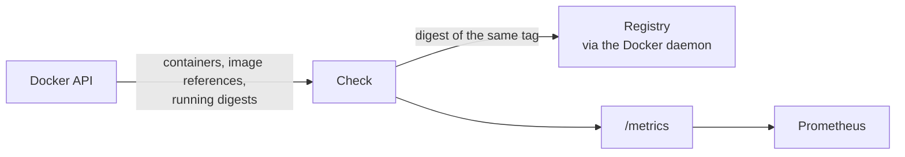

# ImageAdvisor

Which of your containers have a newer image in their registry? As Prometheus metrics.

ImageAdvisor runs as a container next to [cAdvisor](https://github.com/google/cadvisor) and
[node_exporter](https://github.com/prometheus/node_exporter). It reads the Docker API and asks the
registry, through the Docker daemon, whether the tag a container runs points to a newer image than the
one it was started from. It never pulls, restarts or changes anything.

> **Status:** in development (0.x). The exporter skeleton runs (endpoints, config, Docker connection);
> the image check itself is being designed and not available yet. Behavior and metrics may change
> before 1.0.

## Why

- Tools like Watchtower update containers automatically; that is not always wanted.
- Notification tools report updates by mail or chat, but not as metrics next to the rest of the
  monitoring.
- With metrics, "update available for more than two days" is a normal Prometheus alert, and a stuck
  rollout shows up on the same dashboards as everything else.

## How it works



## Requirements

- Linux on `amd64` or `arm64` (the image is multi-arch).
- Docker Engine (rootful) with API 1.41 or newer (Docker 20.10+).

## Quick start

```yaml
services:
  imageadvisor:
    image: ghcr.io/motwok/imageadvisor:latest
    restart: unless-stopped
    volumes:
      - /var/run/docker.sock:/var/run/docker.sock:ro
      - imageadvisor-data:/data        # config.yml
    ports:
      - "8080:8080"
volumes:
  imageadvisor-data:
```

The image already sets `--config.file=/data/config.yml`. Endpoints: `/metrics`, `/-/healthy`,
`/-/ready`, `POST /-/reload`.

## Documentation

- [Install.md](docs/Install.md): running the container, Prometheus, update, uninstall.
- [Configuration.md](docs/Configuration.md): flags and every config key.
- [Metrics.md](docs/Metrics.md): all metrics.
- [Troubleshooting.md](docs/Troubleshooting.md): what to do when something looks wrong.
- [Build.md](docs/Build.md): building, unit and integration tests, coverage.

## Port

> **The default port changes with version 1.0.**
>
> Before 1.0, ImageAdvisor serves `/metrics` on port **8080** (the same default as cAdvisor). With 1.0
> the default changes to a port registered in the Prometheus
> [default port allocations](https://github.com/prometheus/prometheus/wiki/Default-port-allocations).
> If you depend on the port, set it explicitly with `--web.listen-address`, and update your Prometheus
> scrape configuration when you move to 1.0.

## Releases

Every merge into `master` that changes the image is a release (Semantic Versioning), published as
`ghcr.io/motwok/imageadvisor:X.Y.Z` and `:latest`. **Updates of Go and of dependencies are released
automatically too**; read the risks and how to opt out in [RELEASING.md](RELEASING.md). Release notes
are on the [Releases page](https://github.com/motwok/ImageAdvisor/releases), see also
[CHANGELOG.md](CHANGELOG.md).

## Contributing

Bug reports and feature requests go to **GitHub Issues**; **pull requests are welcome**.
See [CONTRIBUTING.md](CONTRIBUTING.md). Security problems are reported privately, see
[SECURITY.md](SECURITY.md). For help, see [SUPPORT.md](SUPPORT.md).

## License

[GNU Affero General Public License v3.0](LICENSE)

## Third-party

ImageAdvisor is written in Go; its only dependency is the YAML parser go-yaml. See [NOTICE](NOTICE).

## Support Me

If you find this project useful, please consider supporting it
by buying me a coffee: [Buy Me a Coffee](https://ko-fi.com/motwok)
