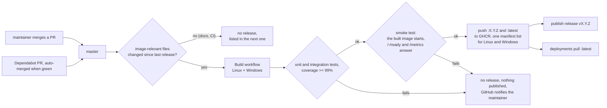

# Releasing ImageAdvisor

ImageAdvisor is released as a container image, `ghcr.io/motwok/imageadvisor`, with
[Semantic Versioning](https://semver.org) (0.x before 1.0). **Every merge into `master` that changes
the image is a release**, that is changes to Go code (not tests), `go.mod`/`go.sum`, the `Dockerfile`
or `Dockerfile.windows`. Merges that only touch documentation or CI build nothing new; they are listed
in the next real release. There is no manual release step: merging a pull request is the approval.

## Workflows at a glance

| Workflow | File | Trigger | What it does |
|---|---|---|---|
| **Build** | `build.yml` | PR to `master`, push to `master`, started by the auto-merge | Runs the unit tests on Linux and Windows, the integration tests (Linux `amd64` and `arm64`, Windows Server 2022 and 2025) and the coverage gate. On `master`, if the image changed since the last release, it builds the image, starts it (smoke test), pushes `:X.Y.Z` and `:latest` to GHCR and then publishes the release `vX.Y.Z`. |
| **Release Drafter** | `release-drafter.yml` | PR events, push to `master` | Labels pull requests from their Conventional Commit titles and keeps the release notes of the next version up to date. |
| **Dependabot** | `.github/dependabot.yml` | daily (Dependabot schedule) | Opens PRs for the Go modules (`go.mod`), the `golang` build image in the `Dockerfile` and the GitHub Actions used. |
| **Dependabot auto-merge** | `dependabot-automerge.yml` | daily | Merges the Dependabot PRs whose checks are green and then starts the Build workflow, because a merge made by the workflow token starts no build of its own. |

All actions are pinned to a commit SHA (with the version as a comment); Dependabot moves the pins.

## Release flow

1. A change is merged into `master` through a PR (feature branch, squash merge).
2. The Build workflow runs the unit tests and the **integration tests**: the Linux image against a
   local registry on `amd64` and `arm64`, with both Docker image stores, and the Windows image on
   Windows Server 2022 and 2025. If a test fails or the test coverage is below 99%, there is no release
   and nothing is published.
3. The release job builds the images without cache: the Linux variants (`amd64`, `arm64`) from the
   pinned `golang` build image, `FROM scratch` with only the static binary; the Windows variants
   (`ltsc2019`, `ltsc2022`, `ltsc2025`) with the cross-compiled binary on the current `nanoserver`
   image. The `ltsc2019` variant is built but not tested in CI (no runner).
4. The **smoke test** starts the Linux image that is about to be pushed and checks that `/-/ready` and
   `/metrics` answer with the right version. If it fails, there is no release and nothing is published.
5. On success all variants are pushed as one manifest list `:X.Y.Z` and `:latest`, each Windows entry
   with its `os.version`, so Docker picks the right variant on every host. Then the release `vX.Y.Z` is
   published with notes generated from the merged pull requests. Tag, release and image always belong
   to the same commit, and a version tag never exists without its image.

## Version numbers

The next version follows from the labels of the merged pull requests:

| Labels | Version step |
|---|---|
| `breaking`, `major` | major |
| `feature`, `enhancement` | minor |
| anything else (`fix`, `docs`, `chore`, `dependencies`, no label) | patch |

Labels are set automatically from Conventional Commit titles (`feat:`, `fix:`, `docs:`, ...).

## Dependency updates are released automatically

**An update of Go or of a dependency becomes a release on its own** (updates of GitHub Actions only
touch CI and do not). Dependabot opens the pull request; once its checks are green, the daily auto-merge
merges it and starts the build, which releases it as a new patch release. If you run `:latest` and
redeploy regularly, you get it without doing anything.

That is how security fixes in Go and its standard library reach you within a few days. It also means:

> **Risk:** if a Go release or a dependency is itself vulnerable or compromised, that is shipped
> automatically as well, before anyone has looked at it.

What limits that risk:

- ImageAdvisor has a single dependency besides the Go standard library (the YAML parser go-yaml).
- `go.sum` pins every module and is checked against the Go checksum database.
- Dependabot waits **3 days** after a new version appears before proposing it (cooldown), so a
  compromised release that is found and pulled quickly never reaches ImageAdvisor. For go-yaml, security
  updates with an advisory are not delayed; Go itself arrives as a base image update and always waits
  the 3 days.
- The `golang` build image is pinned in the `Dockerfile` and only changes through a reviewed-by-CI pull
  request. The tests run with exactly that Go version.
- No release without green tests and smoke test.

If you want to control updates yourself, **pin a version tag** (`:X.Y.Z`) instead of `:latest` and
update deliberately after reading the release notes.

## Rollback

Version tags are never rebuilt. Pin the deployment to the version tag of an earlier release instead of
`:latest`, then switch back to `:latest` once a fixed release is published.

## Deployment

ImageAdvisor only publishes images. Pulling `:latest` and redeploying the container is up to the
deployment, for example a scheduled stack redeploy. No credentials are needed: the repository and the
image are public.

ImageAdvisor reports its own container like every other one, so a stuck redeploy of ImageAdvisor itself
shows up too.
